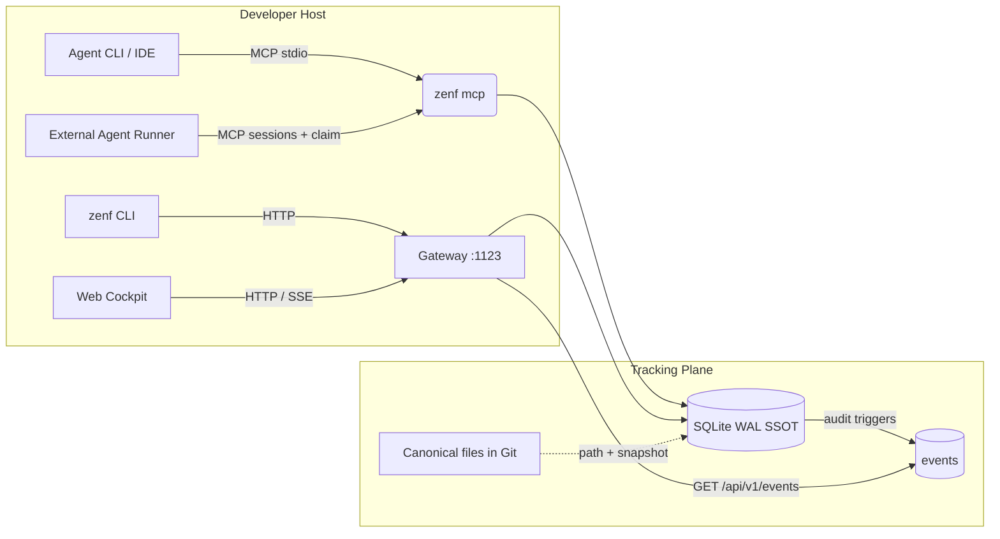

# ZenForge Daemon (zenfd) Architecture & Seams

ZenForge Daemon is an agent-native tracking plane: SQLite WAL is the Single
Source of Truth for execution state, MCP and the CLI are the primary write paths,
and the HTTP gateway serves both the read-only cockpit and definition CRUD for
projects, resources, souls, and agents.



## Domain model (v0.2)

```text
project <- plans <- tasks
```

- A plan always belongs to one project (`project_slug` required).
- A task has exactly one scope: plan task (`plan_slug` + `project_slug`), project
  task (`project_slug`, no plan), or orphan (neither).
- Dependencies are validated within the task's container: `plan:<slug>`,
  `project:<slug>`, or `orphan`.
- Resources are native-first: `content` lives in the SQLite WAL. `path` is an optional
  overlay onto a canonical Git file; the daemon snapshots that file into `content` on
  refresh. `url` is an external http(s) reference, mutually exclusive with `path`, and
  never snapshotted. The scope matrix is enforced: `GLOBAL` has no container,
  `PROJECT` needs `project_slug`, `PLAN`/`TASK` need `project_slug` plus `scope_ref`. The database also stores identity (`key`, `slug`), classification (`kind`,
  `type`, `scope`, `status`), tags, SHA-256, byte size, and an FTS5 snapshot. Keys and
  slugs are unique per project (`IFNULL(project_slug,'')`); global resources have an
  empty project.
- Agent definitions (mode, goal, start/stop conditions, schedule, runner, `soul_key`)
  are stored by the daemon; execution is external. Sessions are observed as `MAIN`,
  `SUBAGENT`, or `WORKER`.
- A **soul** is a resource with `kind='soul'`: the markdown persona and workflow a
  worker adopts. An agent references at most one soul via `soul_key`; one soul may back
  many agents. Soul resolution prefers the task's project and falls back to the global
  scope. Skill selection at claim time is
  `soul.frontmatter.skills ∪ task.required_skills`, gated by the agent's
  `skills` ceiling (soul order first, deduplicated).
- Three context lanes: knowledge (`resources.content`, FTS5), attachments (files in
  `~/.zenforge/attachments/<owner>/`, content-addressed by SHA-256, at most 25 MiB) and
  links (`resources.url`). Artifacts are owner-polymorphic: exactly one of `task_id` or
  `resource_id` is set, and the shared `GET /api/v1/artifacts/{id}` route serves both.
- Claim identity: mutual exclusion lives in the `READY -> RUNNING` transition, never in
  a field. A task bound to an agent may only be claimed by that agent and records it as
  `claimed_by`; an unbound task records the caller's optional `worker_id` or
  `"external"`. `claimed_by` is attribution only — it grants no authorization, and a
  bound task whose agent was deleted or disabled is refused rather than run ungated.

## Boundaries

- **Execution write path**: Unified MCP tools (`zenf_find`, `zenf_create`,
  `zenf_update`, `zenf_delete`, `claim_task`, `transition_task`) and
  the `zenf` CLI. HTTP keeps a public definition/ingestion surface for
  scripted clients, guarded against cross-origin browsers.
- **Definition write path**: the Web Cockpit may CRUD projects, resource registry
  entries (including souls), and agent definitions. It never creates, claims, or
  transitions a task, and never drives a session.
- **Read path**: the cockpit consumes `GET` endpoints plus the SSE stream.
- **Activity log**: database triggers append every project/plan/task/resource/
  agent/artifact mutation to `events`, so writes from MCP or the CLI in
  another process are visible in the cockpit live log. Rows older than 30 days
  are pruned at startup. `StateFingerprint` is `MAX(events.id)`.

## Default ports and storage

| Component | Default |
| :--- | :--- |
| Gateway | `127.0.0.1:1123` |
| Database | `~/.zenforge/state.db` (SQLite WAL) |
| Attachments | `~/.zenforge/attachments/<task>/` |
| Web bundle | Embedded in the single `zenf` binary |

## Migration policy

Schema changes are forward-only migrations embedded in the binary
(`internal/storage/migrations/`). `storage.Open` applies pending steps, records
them in `schema_migrations` with a content checksum, and keeps one
`state.db.pre-migration.bak` recovery point. `v0.1.0` is the frozen baseline
(`0001_baseline.sql`).

The database file is never rotated or renamed. A file that predates the ledger
(anything before v0.1.0) or was written by a newer binary fails closed with an
actionable error instead of being mutated. See `docs/MIGRATIONS.md`.
