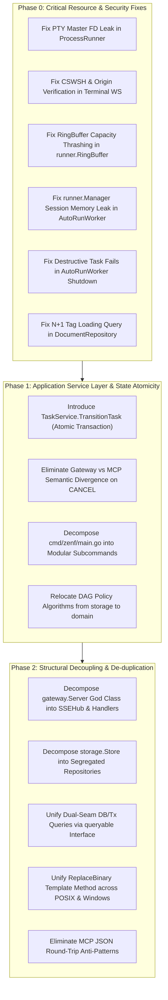

I have initiated concurrent architectural inspections across the `apps/daemon` subsystems and Triaged the CLI control plane (`cmd/zenf/main.go`). Awaiting findings from the inspection subagents to synthesize the final structural dossier.
Standing by for subagent completion. The structural analysis will resume automatically upon receipt of inspection dossiers.
Standing by for the remaining two inspection subagents (Storage & Domain, Gateway & MCP) to deliver their findings.
Standing by for the Storage & Domain subagent to deliver its inspection findings.
Standing by for the Storage & Domain subagent to conclude.
# Structural Inspection Dossier: `apps/daemon`

## 1. Executive Summary
- **Target Inspected**: `apps/daemon` (62 Go source files across `cmd/zenf`, `internal/storage`, `internal/gateway`, `internal/mcp`, `internal/runner`, `internal/updater`, `internal/domain`, `internal/contextpacket`, `internal/attachment`, `internal/parser`)
- **Health Rating**: `CRITICAL_DEBT`
- **Primary Bottleneck**: The absence of an application service layer forces disparate transports (CLI, HTTP Gateway, MCP stdio) and background workers to orchestrate fragmented, non-atomic multi-step domain mutations with duplicate logic, while monolithic God classes and severe resource leaks (unclosed PTY descriptors, continuous ringbuffer heap thrashing, un-pruned session maps, and CSWSH origin bypass) jeopardize system stability, security, and data integrity.

---

## 2. Technical Debt Catalog

### [CRITICAL] Class Cohesion & SRP: `main()` in [`cmd/zenf/main.go`](file:///home/dev/src/owner/zenforge/apps/daemon/cmd/zenf/main.go#L108-L1101)
- **Location**: [`apps/daemon/cmd/zenf/main.go#L108-L1101`](file:///home/dev/src/owner/zenforge/apps/daemon/cmd/zenf/main.go#L108-L1101)
- **Smell**: Mega-Method God Entrypoint. A single 993-line `main()` function constructs, configures, and executes 14 distinct Cobra CLI subcommands via inline closures. It conflates 8 unrelated subsystem concerns into one lexical scope: CLI flag binding, process daemonization/forking, PID file locking, POSIX signal trapping, SQLite storage bootstrapping, HTTP gateway startup, log streaming, ad-hoc HTTP client calls to REST endpoints, terminal character-device detection, MCP client configuration file parsing/patching, and GitHub release downloading/verifying/binary self-replacement.
- **Remedy**: Decompose `cmd/zenf/main.go` into a modular CLI command tree under `apps/daemon/cmd/zenf/commands/`:
  1. `daemon.go`: Daemon lifecycle commands (`start`, `stop`, `logs`).
  2. `plans.go` & `tasks.go`: Thin CLI client commands delegating to a typed `zenfclient.Client` SDK.
  3. `mcp.go`: MCP server execution and configuration setup subcommands.
  4. `update.go`: Self-updater CLI wrapper invoking an encapsulated `updater.Service`.

---

### [CRITICAL] Class Cohesion & SRP: [`gateway.Server`](file:///home/dev/src/owner/zenforge/apps/daemon/internal/gateway/server.go#L41-L61)
- **Location**: [`apps/daemon/internal/gateway/server.go#L41-L61`](file:///home/dev/src/owner/zenforge/apps/daemon/internal/gateway/server.go#L41-L61)
- **Smell**: Monolithic Transport God Class. `Server` simultaneously acts as the HTTP routing multiplexer, Server-Sent Events (SSE) pub/sub hub, SQLite state fingerprint polling loop (`watchStateChanges`), process runner manager container, static SPA file server, runtime environment auditor, and receiver for 22 HTTP/WebSocket route handlers across 7 domain aggregates (projects, plans, tasks, documents, agents, sessions, search).
- **Remedy**: Decompose `Server` into single-responsibility components:
  1. `SSEHub`: Encapsulates SSE client channel registration, heartbeat keepalive, and thread-safe event broadcasting.
  2. `StateWatcher`: Standalone background worker managing fingerprint polling and triggering invalidations.
  3. Domain HTTP Handlers: Dedicated structs (`TaskHandler`, `PlanHandler`, `ProjectHandler`, `DocHandler`, `AgentHandler`, `SessionHandler`) declaring explicit domain service dependencies.
  4. Retain `Server` strictly as an HTTP composition root and graceful shutdown coordinator.

---

### [CRITICAL] Class Cohesion & SRP: [`storage.Store`](file:///home/dev/src/owner/zenforge/apps/daemon/internal/storage/store.go#L20-L56)
- **Location**: [`apps/daemon/internal/storage/store.go#L20-L56`](file:///home/dev/src/owner/zenforge/apps/daemon/internal/storage/store.go#L20-L56)
- **Smell**: Monolithic Facade God Struct. `Store` embeds 11 repository pointers (`ProjectRepository`, `PlanRepository`, `TaskRepository`, `TaskLifecycle`, `DocumentRepository`, `AgentRepository`, `SessionRepository`, `ArtifactRepository`, `EventRepository`, `StateFingerprinter`, `SearchRepository`), promoting 58 distinct methods onto a single struct. Both `gateway.Storage` and `mcp.Storage` bundle 9-10 of these interfaces into composite contracts, destroying aggregate boundaries and forcing callers to depend on the entire database surface.
- **Remedy**: Decompose `Store` from an all-encompassing facade into an explicit repository registry. Transports and application services must depend on segregated domain interfaces (e.g., `domain.TaskRepository`, `domain.PlanRepository`) rather than a composite God storage interface.

---

### [CRITICAL] Robustness & Resource Hygiene: Master PTY File Descriptor Leak in [`runner.ProcessRunner`](file:///home/dev/src/owner/zenforge/apps/daemon/internal/runner/runner.go#L198-L305)
- **Location**: [`apps/daemon/internal/runner/runner.go#L198, L218-L228, L298-L305`](file:///home/dev/src/owner/zenforge/apps/daemon/internal/runner/runner.go#L198-L305)
- **Smell**: Systemic File Descriptor Leak. In `StartInteractive`, `ptmx, err := pty.StartWithSize(...)` allocates an OS master pseudo-terminal file descriptor (`*os.File`). However, `ptmx.Close()` is never called anywhere in `ProcessRunner` (it does not exist in the entire codebase) — neither in the read loop upon receiving EOF/EIO, nor in the process reaping goroutine, nor in `Abort()`. In a long-running daemon hosting interactive sessions, `/dev/ptmx` file descriptors accumulate until the process exhausts OS file limits (`EMFILE`) and crashes.
- **Remedy**: Enforce deterministic disposal of `ptmx` via a `sync.Once` block triggered on reader pump termination (EOF/EIO error), upon process exit in the reap goroutine, and within `Abort()`.

---

### [CRITICAL] Robustness & Resource Hygiene: Continuous Heap Reallocation Thrashing in [`runner.RingBuffer`](file:///home/dev/src/owner/zenforge/apps/daemon/internal/runner/ringbuffer.go#L45-L49)
- **Location**: [`apps/daemon/internal/runner/ringbuffer.go#L45-L49`](file:///home/dev/src/owner/zenforge/apps/daemon/internal/runner/ringbuffer.go#L45-L49)
- **Smell**: Defeated Circular Buffer Allocation. When `RingBuffer.Write` encounters an overflow, it executes `r.buf = r.buf[overflow:]`. In Go, reslicing from an offset shrinks the slice's capacity (`cap(r.buf)` decreases by `overflow`). The subsequent `append(r.buf, p...)` detects that `len(r.buf) + n > cap(r.buf)` and triggers a brand-new backing array allocation on every overflowing write. Under active streaming, this creates extreme heap allocation thrashing and GC pressure, defeating the core purpose of a preallocated ring buffer.
- **Remedy**: Implement a true circular ring buffer with a fixed preallocated byte array and read/write offset pointers, or retain capacity by copying remaining bytes to index 0: `copy(r.buf, r.buf[overflow:])` followed by `r.buf = r.buf[:len(r.buf)-overflow]`.

---

### [CRITICAL] Robustness & Resource Hygiene: CSWSH Security Vulnerability & Unbounded Write Blocking in [`gateway.Server.handleSessionTerminal`](file:///home/dev/src/owner/zenforge/apps/daemon/internal/gateway/terminal_ws.go#L26-L28)
- **Location**: [`apps/daemon/internal/gateway/terminal_ws.go#L26-L28, L57-L61`](file:///home/dev/src/owner/zenforge/apps/daemon/internal/gateway/terminal_ws.go#L26-L28)
- **Smell**: Cross-Site WebSocket Hijacking (CSWSH) and DoS Hazard. `terminalUpgrader.CheckOrigin` unconditionally returns `true`. Because GET requests are exempt from CSRF checks in `allowRequest(r)` ([`server.go#L202`](file:///home/dev/src/owner/zenforge/apps/daemon/internal/gateway/server.go#L202)), any malicious website opened in the user's browser can connect to `ws://127.0.0.1:1123/api/v1/sessions/{id}/terminal` and inject arbitrary commands (`OpcodeData`) into interactive terminal sessions. Additionally, `safeWrite` executes without `conn.SetWriteDeadline`, allowing slow clients to freeze streaming goroutines indefinitely.
- **Remedy**: Restrict WebSocket origins by setting `CheckOrigin: func(r *http.Request) bool { return allowRequest(r) }` to enforce loopback validation, and set write deadlines on all socket transmissions (`conn.SetWriteDeadline(time.Now().Add(5 * time.Second))`).

---

### [CRITICAL] Robustness & Resource Hygiene: Unbounded Memory Leak in [`runner.Manager`](file:///home/dev/src/owner/zenforge/apps/daemon/internal/gateway/autorun_worker.go#L137-L139) from [`AutoRunWorker`](file:///home/dev/src/owner/zenforge/apps/daemon/internal/gateway/autorun_worker.go#L137-L139)
- **Location**: [`apps/daemon/internal/gateway/autorun_worker.go#L137-L139`](file:///home/dev/src/owner/zenforge/apps/daemon/internal/gateway/autorun_worker.go#L137-L139) & [`apps/daemon/internal/runner/manager.go#L49-L53`](file:///home/dev/src/owner/zenforge/apps/daemon/internal/runner/manager.go#L49-L53)
- **Smell**: Indefinite Session Retention. For each automated task execution, `AutoRunWorker` generates a unique `sessionID` and registers the runner into `w.server.runnerMgr.Register(sessionID, rnr)`. However, `runnerMgr.Unregister(sessionID)` is never invoked anywhere upon task completion or exit. Each runner permanently retains its 1 MiB ring buffer and metadata in memory. In a daemon executing hundreds of automated tasks, `runner.Manager.sessions` grows unbounded.
- **Remedy**: Invoke `defer w.server.runnerMgr.Unregister(sessionID)` in `executeTask` immediately upon registration, or equip `runner.Manager` with a listener that automatically removes sessions when `rnr.Done()` signals.

---

### [CRITICAL] Robustness & Resource Hygiene: Unguarded Goroutines and Destructive Shutdown in [`gateway.AutoRunWorker`](file:///home/dev/src/owner/zenforge/apps/daemon/internal/gateway/autorun_worker.go#L70-L168)
- **Location**: [`apps/daemon/internal/gateway/autorun_worker.go#L70, L142-L168`](file:///home/dev/src/owner/zenforge/apps/daemon/internal/gateway/autorun_worker.go#L70) & [`apps/daemon/internal/gateway/server.go#L305-L319`](file:///home/dev/src/owner/zenforge/apps/daemon/internal/gateway/server.go#L305-L319)
- **Smell**: Destructive Cancellation on Daemon Shutdown. `AutoRunWorker.Tick` launches task execution routines as unmonitored goroutines (`go w.executeTask(ctx, task)`) without a `sync.WaitGroup`. When `Server.Shutdown` cancels `ctx`, running OS processes are abruptly terminated, causing `rnr.Wait()` to return an error. `executeTask` then unconditionally updates task status to `FAILED` in the database via `context.Background()`. Consequently, restarting or stopping the daemon corrupts active tasks by marking them failed instead of releasing them back to `READY`.
- **Remedy**: Track worker goroutines with a `sync.WaitGroup`. Differentiate between graceful daemon cancellation (`ctx.Err() != nil`) and command exit codes; on shutdown, evict running tasks back to `READY` via `EvictTask(..., "SHUTDOWN", "RESET_TO_READY")`. Provide an explicit `Stop(ctx)` method called during server shutdown.

---

### [CRITICAL] Robustness & Resource Hygiene: N+1 Connection Pool Exhaustion in [`storage.DocumentRepository`](file:///home/dev/src/owner/zenforge/apps/daemon/internal/storage/document_store.go#L280-L291)
- **Location**: [`apps/daemon/internal/storage/document_store.go#L280-L291, L469-L489`](file:///home/dev/src/owner/zenforge/apps/daemon/internal/storage/document_store.go#L280-L291)
- **Smell**: Nested Query on Open Cursors. While iterating over active `sql.Rows` in `ListDocuments` and `SearchDocuments`, `r.finalizeDocument` executes an independent query `r.loadTags(ctx, document.ID)` for *every single row*. Executing secondary queries while an outer `sql.Rows` holds a pooled connection risks deadlocks and connection pool starvation under SQLite's strict connection ceilings (e.g. `maxConns = 1` in test `:memory:` mode or `4` in WAL).
- **Remedy**: Fetch document tags eagerly in the primary query using SQLite's `json_group_array(dt.tag)` with a `LEFT JOIN document_tags dt`, or batch-load tags with a single `IN (...)` query after closing the document `rows` cursor.

---

### [CRITICAL] Systemic Duplication & Divergence: Task Transition Orchestration between [`gateway`](file:///home/dev/src/owner/zenforge/apps/daemon/internal/gateway/task_handlers.go#L107-L196) and [`mcp`](file:///home/dev/src/owner/zenforge/apps/daemon/internal/mcp/tool_lifecycle.go#L194-L258)
- **Location**: [`apps/daemon/internal/gateway/task_handlers.go#L107-L196`](file:///home/dev/src/owner/zenforge/apps/daemon/internal/gateway/task_handlers.go#L107-L196) vs [`apps/daemon/internal/mcp/tool_lifecycle.go#L194-L258`](file:///home/dev/src/owner/zenforge/apps/daemon/internal/mcp/tool_lifecycle.go#L194-L258)
- **Smell**: Macro Duplication with Semantic Defect. Both HTTP and MCP transport layers independently orchestrate multi-step task state transitions: evaluating transitions via `domain.EvaluateTransition`, updating phase metadata, invoking `EvictTask` for resets, updating status with audit notes, and appending task notes. Crucially, they have diverged in behavior:
  - In `mcp/tool_lifecycle.go` (L234-L247), action `CANCEL` invokes `s.store.EvictTask(..., "CANCEL")`, clearing the worker assignment and session lock.
  - In `gateway/task_handlers.go` (L145-L170), only action `RESET` invokes `EvictTask`. Action `CANCEL` falls through to `UpdateTaskStatusWithNote`, leaving the worker assignment and lock active on the cancelled task!
- **Remedy**: Consolidate transition orchestration into a single atomic application service method `TaskService.TransitionTask(...)`. Both HTTP handlers and MCP tools must delegate directly to this service.

---

### [CRITICAL] Coupling & Encapsulation Bleed: Fragmented State Machine & Non-Atomic Transport Handshake
- **Location**: [`apps/daemon/internal/mcp/tool_lifecycle.go#L200-L235`](file:///home/dev/src/owner/zenforge/apps/daemon/internal/mcp/tool_lifecycle.go#L200-L235), [`apps/daemon/internal/gateway/task_handlers.go#L120-L165`](file:///home/dev/src/owner/zenforge/apps/daemon/internal/gateway/task_handlers.go#L120-L165), & [`apps/daemon/internal/storage/task_lifecycle.go#L40-L96`](file:///home/dev/src/owner/zenforge/apps/daemon/internal/storage/task_lifecycle.go#L40-L96)
- **Smell**: Non-Atomic Multi-Transaction Mutations with Swallowed Errors. Transition orchestration is fragmented across the domain, transport, and storage layers. Transport layers call `domain.EvaluateTransition`, then invoke `store.UpdateTaskMetadata` (for phases) while discarding errors (`_ = ...`), then execute `store.UpdateTaskStatusWithNote` in a separate transaction, and finally call `store.AppendTaskNotes`. If the phase update succeeds but the status update fails, the task is left with partially mutated phase state (torn state).
- **Remedy**: Introduce an atomic method on `TaskLifecycle` or an application service: `TransitionTask(ctx context.Context, taskID string, req domain.TransitionTaskRequest) (*domain.TransitionTaskResult, error)`. Execute transition evaluation, phase updating, status mutation, DAG unblocking, and note appending within a single `db.ExecImmediate` transaction.

---

### [CRITICAL] Method & Flow Complexity: [`domain.EvaluateTransition`](file:///home/dev/src/owner/zenforge/apps/daemon/internal/domain/task_lifecycle.go#L32-L227)
- **Location**: [`apps/daemon/internal/domain/task_lifecycle.go#L32-L227`](file:///home/dev/src/owner/zenforge/apps/daemon/internal/domain/task_lifecycle.go#L32-L227)
- **Smell**: Arrow Anti-Pattern with Deep Cyclomatic Complexity. A 195-line monolithic method with cyclomatic complexity exceeding 25 and 5 levels of nested branching (outer `switch action`, inner `switch task.Status`, innermost `switch req.MergeOutcome`, loops searching phases, and conditional error branches).
- **Remedy**: Refactor `EvaluateTransition` using action-specific handlers: `evaluateComplete`, `evaluateCheckpoint`, `evaluateFail`, `evaluateReset`, `evaluateCancel`. Encapsulate intra-task phase state transitions into a dedicated domain method `task.AdvancePhase(phaseID string, status PhaseStatus)`.

---

### [MAJOR] Class Cohesion & SRP: [`storage.TaskLifecycle`](file:///home/dev/src/owner/zenforge/apps/daemon/internal/storage/task_lifecycle.go#L17-L26)
- **Location**: [`apps/daemon/internal/storage/task_lifecycle.go#L17-L26, L100-L166`](file:///home/dev/src/owner/zenforge/apps/daemon/internal/storage/task_lifecycle.go#L17-L26)
- **Smell**: Circular Dependency & Layer Inversion. `TaskLifecycle` is situated inside `package storage`, yet it orchestrates application-level concerns: holding a reference to `domain.ContextPacketBuilder`, compiling LLM Markdown prompts, verifying media attachments, enforcing claim mutual exclusion, and managing reviews. This creates a circular dependency: `storage` depends on `domain.ContextPacketBuilder`, whose implementation in `internal/contextpacket` depends back on `storage` repository readers.
- **Remedy**: Relocate lifecycle coordination to an application service `internal/app/task_service.go`. The application service coordinates prompt compilation and claim semantics, delegating persistence strictly to atomic repository operations.

---

### [MAJOR] Class Cohesion & SRP: DAG Topology Trapped in [`storage/dag_policy.go`](file:///home/dev/src/owner/zenforge/apps/daemon/internal/storage/dag_policy.go#L164-L329)
- **Location**: [`apps/daemon/internal/storage/dag_policy.go#L164-L329`](file:///home/dev/src/owner/zenforge/apps/daemon/internal/storage/dag_policy.go#L164-L329)
- **Smell**: Domain Invariants Implemented in Storage. Pure graph topology algorithms—such as DFS cycle detection (`findCycle`), graph validation (`validateGraph`), status resolution (`deriveStatus`), and dependent unrolling (`blockDependentsOf`, `unlockDependents`)—are core domain invariants with zero database dependencies, yet they are implemented inside `storage`. Single-task transitions live in `domain`, but multi-task DAG transitions live in `storage`.
- **Remedy**: Move DAG topology algorithms to `internal/domain/dag.go`. Define a pure domain entity `TaskGraph` with methods `Validate()`, `DetectCycle()`, `DeriveStatus()`, and `CascadingUpdates()`. Keep `storage` responsible solely for loading nodes and writing updated statuses.

---

### [MAJOR] Class Cohesion & SRP: Conflated Aggregates in [`storage/agent_store.go`](file:///home/dev/src/owner/zenforge/apps/daemon/internal/storage/agent_store.go#L14-L401)
- **Location**: [`apps/daemon/internal/storage/agent_store.go#L14-L230, L232-L401`](file:///home/dev/src/owner/zenforge/apps/daemon/internal/storage/agent_store.go#L14-L401)
- **Smell**: Multi-Aggregate Source File. `agent_store.go` houses two distinct aggregate roots with completely different lifecycles: `AgentRepository` (reusable agent definitions, models, schedules) and `SessionRepository` (ephemeral runner session tracking, heartbeats, termination).
- **Remedy**: Extract `SessionRepository`, `scanSession`, and `sessionSelectColumns` into a dedicated file `apps/daemon/internal/storage/session_store.go`.

---

### [MAJOR] Class Cohesion & SRP: [`runner.Runner`](file:///home/dev/src/owner/zenforge/apps/daemon/internal/runner/runner.go#L22-L35) Interface Segregation Violation
- **Location**: [`apps/daemon/internal/runner/runner.go#L22-L35`](file:///home/dev/src/owner/zenforge/apps/daemon/internal/runner/runner.go#L22-L35)
- **Smell**: ISP Violation. The `Runner` interface forces batch/headless execution (`StartHeadless`) and interactive terminal manipulation (`StartInteractive`, `WriteInput`, `Resize`) into a single contract. As a result, implementations must include runtime guard branches returning errors when headless callers invoke interactive methods.
- **Remedy**: Segregate into two interfaces: `Runner` (core lifecycle: `Start`, `Wait`, `Abort`, `Done`, `ExitCode`, `Subscribe`) and `InteractiveRunner` (embedding `Runner` plus `WriteInput`, `Resize`, and backpressure control).

---

### [MAJOR] Class Cohesion & SRP: CLI Host Configurator inside [`mcp/setup.go`](file:///home/dev/src/owner/zenforge/apps/daemon/internal/mcp/setup.go#L1-L446)
- **Location**: [`apps/daemon/internal/mcp/setup.go#L1-L446`](file:///home/dev/src/owner/zenforge/apps/daemon/internal/mcp/setup.go#L1-L446)
- **Smell**: Administrative Tooling Co-located with Protocol Engine. `internal/mcp` is intended for the stdio JSON-RPC protocol server. However, `setup.go` contains 446 lines of CLI host setup code: locating user home directories, editing third-party configuration files (`~/.claude.json`, `~/.cursor/mcp.json`, `~/.config/opencode/opencode.json`), backing up files, and inspecting PATH.
- **Remedy**: Relocate `setup.go` out of `internal/mcp` into an administrative package (e.g. `apps/daemon/internal/cli/mcpsetup`).

---

### [MAJOR] Systemic Duplication: Dual-Seam Queries (`Get<Entity>` vs `get<Entity>Tx`) across Storage
- **Location**:
  - [`project_store.go#L59-L69, L168-L178`](file:///home/dev/src/owner/zenforge/apps/daemon/internal/storage/project_store.go#L59-L69)
  - [`plan_store.go#L107-L117, L218-L228`](file:///home/dev/src/owner/zenforge/apps/daemon/internal/storage/plan_store.go#L107-L117)
  - [`task_store.go#L337-L347, L584-L594`](file:///home/dev/src/owner/zenforge/apps/daemon/internal/storage/task_store.go#L337-L347)
  - [`agent_store.go#L98-L108, L203-L213`](file:///home/dev/src/owner/zenforge/apps/daemon/internal/storage/agent_store.go#L98-L108)
  - [`document_store.go#L186-L199, L395-L405`](file:///home/dev/src/owner/zenforge/apps/daemon/internal/storage/document_store.go#L186-L199)
- **Smell**: Redundant Seam Duplication. Every store maintains two identical implementations for fetching an entity by key/ID: one for `r.db.QueryRow` and one for `tx.QueryRowContext`. SQL queries, column projections, scan invocations, and error translations are duplicated verbatim.
- **Remedy**: Define a query executor interface `type queryable interface { QueryRowContext(...); QueryContext(...) }` and unify `GetX` and `getXTx` into a single helper `queryX(ctx, q, id)`.

---

### [MAJOR] Systemic Duplication: [`ReplaceBinary`](file:///home/dev/src/owner/zenforge/apps/daemon/internal/updater/replace_posix.go#L33-L87) across POSIX & Windows
- **Location**: [`apps/daemon/internal/updater/replace_posix.go#L33-L87`](file:///home/dev/src/owner/zenforge/apps/daemon/internal/updater/replace_posix.go#L33-L87) vs [`apps/daemon/internal/updater/replace_windows.go#L24-L69`](file:///home/dev/src/owner/zenforge/apps/daemon/internal/updater/replace_windows.go#L24-L69)
- **Smell**: 90% Code Duplication. Both files duplicate temporary file creation, writing new binary bytes, renaming the running binary to `.old`, moving the temp file to the target path, rolling back on failure, and removing legacy binaries. The only differences are POSIX `Chmod(0755)` and the legacy executable suffix (`zenfd` vs `zenfd.exe`).
- **Remedy**: Unify `ReplaceBinary` into a single platform-agnostic implementation using the Template Method pattern, extracting only `setExecutablePermissions(path)` and `legacyExecutableNames() []string` into OS-gated files.

---

### [MAJOR] Systemic Duplication: Ad-Hoc Attachment Ingestion in [`gateway`](file:///home/dev/src/owner/zenforge/apps/daemon/internal/gateway/task_handlers.go#L284-L336) vs [`attachment.Ingest`](file:///home/dev/src/owner/zenforge/apps/daemon/internal/attachment/ingest.go#L48-L100)
- **Location**: [`apps/daemon/internal/gateway/task_handlers.go#L284-L336`](file:///home/dev/src/owner/zenforge/apps/daemon/internal/gateway/task_handlers.go#L284-L336) vs [`apps/daemon/internal/attachment/ingest.go#L48-L100`](file:///home/dev/src/owner/zenforge/apps/daemon/internal/attachment/ingest.go#L48-L100)
- **Smell**: Duplicate Ingestion Pipeline. `handleUploadTaskAttachment` re-implements 50 lines of attachment storage (directory resolution, ID generation with unix nano, SHA-256 calculation via `io.MultiWriter`, file writing, and MIME detection) solely because `attachment.Ingest` only accepts a file path string (`srcPath`) instead of an `io.Reader`. In doing so, it introduces file-locking bugs and missing cleanup handlers that `attachment.Ingest` had already solved.
- **Remedy**: Introduce `attachment.IngestStream(taskID string, r io.Reader, filename, displayName string, byteSize int64) (domain.Artifact, error)` and re-implement both `attachment.Ingest` and `handleUploadTaskAttachment` on top of it.

---

### [MAJOR] Systemic Duplication: JSON Round-Trip Anti-pattern across MCP Tool Handlers
- **Location**:
  - [`tool_tasks.go#L160-L167, L260-L267`](file:///home/dev/src/owner/zenforge/apps/daemon/internal/mcp/tool_tasks.go#L160-L167)
  - [`tool_lifecycle.go#L141-L158`](file:///home/dev/src/owner/zenforge/apps/daemon/internal/mcp/tool_lifecycle.go#L141-L158)
  - [`tool_plans.go#L143-L153`](file:///home/dev/src/owner/zenforge/apps/daemon/internal/mcp/tool_plans.go#L143-L153)
  - [`tool_projects.go#L113-L125`](file:///home/dev/src/owner/zenforge/apps/daemon/internal/mcp/tool_projects.go#L113-L125)
  - [`tool_docs.go#L275-L288`](file:///home/dev/src/owner/zenforge/apps/daemon/internal/mcp/tool_docs.go#L275-L288)
  - [`tool_agents.go#L119-L138`](file:///home/dev/src/owner/zenforge/apps/daemon/internal/mcp/tool_agents.go#L119-L138)
- **Smell**: Redundant Serialization Overhead. Across 7 tool handlers, tool arguments already parsed into `map[string]any` are re-marshaled to JSON via `json.Marshal` and then immediately unmarshaled into concrete target structs via `json.Unmarshal`.
- **Remedy**: Use a map decoder (e.g. `mapstructure.Decode`) or strongly typed extractor helpers to map `map[string]any` directly into Go structs without serializing to JSON bytes.

---

### [MAJOR] Coupling & Encapsulation Bleed: Raw Domain Entities Leaked to HTTP Request/Response Payloads
- **Location**: [`apps/daemon/internal/gateway/task_handlers.go#L418-L423`](file:///home/dev/src/owner/zenforge/apps/daemon/internal/gateway/task_handlers.go#L418-L423), [`project_handlers.go#L25-L30`](file:///home/dev/src/owner/zenforge/apps/daemon/internal/gateway/project_handlers.go#L25-L30), & [`agent_handlers.go#L25-L30`](file:///home/dev/src/owner/zenforge/apps/daemon/internal/gateway/agent_handlers.go#L25-L30)
- **Smell**: Missing DTO Seams. HTTP endpoints decode JSON request payloads directly into domain structs (`domain.Task`, `domain.Project`, `domain.Agent`). This allows external callers to overwrite internal fields (e.g. timestamps, status flags, version counters) bypassing entity validation and constructors.
- **Remedy**: Introduce explicit input Data Transfer Objects (DTOs) with validation, mapping them to domain entities via factory functions.

---

### [MAJOR] Coupling & Encapsulation Bleed: Leaked Storage Deserialization Flag on [`domain.Task`](file:///home/dev/src/owner/zenforge/apps/daemon/internal/domain/entities.go#L196-L200)
- **Location**: [`apps/daemon/internal/domain/entities.go#L196-L200`](file:///home/dev/src/owner/zenforge/apps/daemon/internal/domain/entities.go#L196-L200)
- **Smell**: Database Leaking into Domain. `domain.Task` contains `DependenciesCorrupt bool json:"-"` with an explicit code comment admitting: *"It is internal to storage and never serialized..."*. Domain logic in `storage/task_lifecycle.go` and `domain/entities.go` must branch on an internal SQLite JSON parsing failure.
- **Remedy**: Remove `DependenciesCorrupt` from `domain.Task`. If storage encounters malformed dependency JSON during `scanTask`, fail fast with a typed domain error (`ErrInvalidGraph`).

---

### [MAJOR] Polymorphism & Strategy Deficits: Scattered Task Status Rules across 7 Files
- **Location**:
  - [`domain/entities.go#L37-L80`](file:///home/dev/src/owner/zenforge/apps/daemon/internal/domain/entities.go#L37-L80) (`CanTransitionTo`)
  - [`domain/task_lifecycle.go#L61-L226`](file:///home/dev/src/owner/zenforge/apps/daemon/internal/domain/task_lifecycle.go#L61-L226) (`EvaluateTransition`)
  - [`storage/task_lifecycle.go#L41-L94`](file:///home/dev/src/owner/zenforge/apps/daemon/internal/storage/task_lifecycle.go#L41-L94) (`updateTaskStatus`)
  - [`storage/dag_policy.go#L230-L260`](file:///home/dev/src/owner/zenforge/apps/daemon/internal/storage/dag_policy.go#L230-L260) (`deriveStatus`)
  - [`storage/dag_policy.go#L215-L225`](file:///home/dev/src/owner/zenforge/apps/daemon/internal/storage/dag_policy.go#L215-L225) (`blockDependentsOf`)
  - [`storage/artifact_store.go#L72-L78`](file:///home/dev/src/owner/zenforge/apps/daemon/internal/storage/artifact_store.go#L72-L78) (`assertInputAllowed`)
  - [`storage/task_store.go#L458, L603`](file:///home/dev/src/owner/zenforge/apps/daemon/internal/storage/task_store.go#L458) (`UpdateTaskMetadata`, `UpdateTaskDependencies`)
- **Smell**: Shotgun Surgery on Task Status. Rules governing status capabilities are scattered across 7 files. Each site maintains independent hardcoded `switch` or `if` cascades checking status eligibility (e.g., whether metadata can be patched, dependencies updated, input artifacts attached, or dependents unblocked).
- **Remedy**: Centralize status capabilities and transition rules on `TaskStatus` in `domain/entities.go`:
  ```go
  func (s TaskStatus) CanModifyMetadata() bool
  func (s TaskStatus) CanModifyDependencies() bool
  func (s TaskStatus) AllowsInputAttachments() bool
  func (s TaskStatus) IsTerminal() bool
  ```

---

### [MAJOR] Robustness & Resource Hygiene: Goroutine Leak & Condition Variable Deadlock on Abort in [`runner.ProcessRunner`](file:///home/dev/src/owner/zenforge/apps/daemon/internal/runner/runner.go#L213-L305)
- **Location**: [`apps/daemon/internal/runner/runner.go#L213-L215, L288-L295, L298-L305`](file:///home/dev/src/owner/zenforge/apps/daemon/internal/runner/runner.go#L213-L305)
- **Smell**: Deadlock on Abort. In `StartInteractive`, the PTY reader pump enforces backpressure via `for pr.paused { pr.pauseCond.Wait() }`. If backpressure is active (`pr.paused == true`) when the process terminates or `Abort()` is invoked, `Abort()` does not unpause or wake `pauseCond`. The pump goroutine remains blocked on `pauseCond.Wait()` permanently, leaking the goroutine and its stack.
- **Remedy**: Introduce a `stopped` flag. In `Abort()` and upon process exit, set `pr.stopped = true`, broadcast `pr.pauseCond.Broadcast()`, and ensure the pump loop exits immediately when `stopped` is true.

---

### [MAJOR] Robustness & Resource Hygiene: Swallowed Errors in Database Serialization
- **Location**: [`apps/daemon/internal/storage/task_store.go#L159-L168, L542-L551`](file:///home/dev/src/owner/zenforge/apps/daemon/internal/storage/task_store.go#L159-L168) & [`task_lifecycle.go#L251-L254`](file:///home/dev/src/owner/zenforge/apps/daemon/internal/storage/task_lifecycle.go#L251-L254)
- **Smell**: Silent Data Corruption. In `taskArgs` and `updateTaskAuthoringTx`, 10 consecutive `json.Marshal` calls discard errors using blank identifiers `_`. In `RequestReview`, if `json.Marshal(options)` fails, the error is discarded and replaced with `[]byte("[]")`. If corrupt data enters a slice, it silently writes empty JSON to SQLite without surfacing an error.
- **Remedy**: Return and propagate JSON encoding errors in `taskArgs` and `updateTaskAuthoringTx`.

---

### [MINOR] Robustness & Resource Hygiene: Hardcoded POSIX `tail` in [`cmd/zenf/main.go`](file:///home/dev/src/owner/zenforge/apps/daemon/cmd/zenf/main.go#L351)
- **Location**: [`apps/daemon/cmd/zenf/main.go#L351`](file:///home/dev/src/owner/zenforge/apps/daemon/cmd/zenf/main.go#L351)
- **Smell**: OS Incompatibility. `tailCmd := exec.Command("tail", "-n", "50", "-f", logFile)` executes the POSIX `tail` binary directly. Running `zenf daemon logs` on Windows fails immediately with an executable not found error.
- **Remedy**: Implement a cross-platform log tailer in pure Go using `os.Open`, `io.Seek`, and an active polling loop.

---

### [MINOR] Robustness & Resource Hygiene: Windows Stale Backup Leak in [`replace_windows.go`](file:///home/dev/src/owner/zenforge/apps/daemon/internal/updater/replace_windows.go#L44-L68)
- **Location**: [`apps/daemon/internal/updater/replace_windows.go#L44-L68`](file:///home/dev/src/owner/zenforge/apps/daemon/internal/updater/replace_windows.go#L44-L68)
- **Smell**: Disk Leak on Windows. While `replace_posix.go` deletes the `.old` backup binary after a successful swap, `replace_windows.go` omits this step. Every update on Windows leaves an orphaned `.old` executable permanently on disk.
- **Remedy**: Add `_ = os.Remove(backupPath)` at the end of `replace_windows.go:ReplaceBinary`.

---

### [MINOR] Class Cohesion & SRP: Filesystem I/O in [`domain/document.go`](file:///home/dev/src/owner/zenforge/apps/daemon/internal/domain/document.go#L32-L52)
- **Location**: [`apps/daemon/internal/domain/document.go#L32-L52`](file:///home/dev/src/owner/zenforge/apps/daemon/internal/domain/document.go#L32-L52)
- **Smell**: Domain Layer I/O Leak. `ReadTextSnapshot` performs raw filesystem I/O (`os.Stat`, `os.ReadFile`) directly within the domain package. Domain models should remain pure and decoupled from host I/O.
- **Remedy**: Relocate `ReadTextSnapshot` into an infrastructure package (`filestore` or OS adapter). Callers should pass raw content or inject a `FileReader` interface.

---

## 3. Prioritized Architectural Remediation Roadmap



1. **Phase 0: Immediate Safety, Security & Resource Hygiene (P0)**
   - Fix `/dev/ptmx` descriptor leak in `runner/runner.go` by guaranteeing `ptmx.Close()` on reader EOF/EIO and `Abort()`.
   - Remediate CSWSH vulnerability in `gateway/terminal_ws.go` by enforcing loopback origin checks on WebSocket upgrades.
   - Fix continuous heap allocations in `runner/ringbuffer.go` by preserving slice capacity with `copy()`.
   - Prevent unbounded memory growth by deferring `runnerMgr.Unregister(sessionID)` in `gateway/autorun_worker.go`.
   - Fix graceful shutdown in `AutoRunWorker` to evict active tasks to `READY` rather than unconditionally marking them `FAILED`.
   - Fix N+1 connection pool starvation in `storage/document_store.go` via `json_group_array(tag)`.

2. **Phase 1: Application Service Layer & State Atomicity (P1)**
   - Create an application service (`TaskService`) containing an atomic `TransitionTask` method. Migrate both Gateway and MCP to this single method, fixing the `CANCEL` eviction divergence.
   - Deconstruct `cmd/zenf/main.go` into focused subcommand packages.
   - Move pure DAG graph validation, cycle detection, and dependent resolution from `storage/dag_policy.go` into `domain/dag.go`.

3. **Phase 2: Structural Decoupling & De-duplication (P2)**
   - Decompose `gateway.Server` into `SSEHub`, `StateWatcher`, and discrete HTTP handler controllers.
   - Decompose `storage.Store` into segregated domain repository interfaces.
   - Unify dual-seam `GetX` vs `getXTx` queries across all 5 storage files using a shared `queryable` interface.
   - Unify `ReplaceBinary` between POSIX and Windows using the Template Method pattern.
   - Replace JSON round-tripping in MCP tools with direct map-to-struct decoders.
